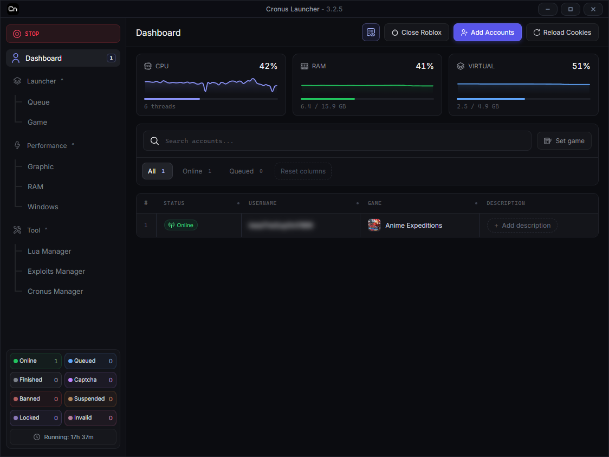

<p align="center">
  <a href="https://github.com/xspww/Khabarovsk">
    
  </a>
</p>

<h1 align="center">Cronus Launcher</h1>

<p align="center">ลอนเชอร์ Roblox หลายบัญชีแบบโอเพนซอร์สสำหรับ Windows — จัดคิวเปิดหลายบัญชีพร้อมกัน รีจอยอัตโนมัติเมื่อหลุด ปล่อย AFK farm และคุม FPS / RAM / CPU จากแดชบอร์ดเดียว</p>

<p align="center">
  <a href="https://github.com/xspww/Khabarovsk/releases"></a>
  <a href="https://github.com/xspww/Khabarovsk/actions/workflows/ci.yml"></a>
  <a href="LICENSE"></a>
  
  
</p>

<p align="center">
  <a href="README.md">English</a> |
  ไทย
</p>

<p align="center">
  <a href="https://xspww.github.io/Khabarovsk/"><b>เว็บไซต์</b></a> ·
  <a href="https://github.com/xspww/Khabarovsk/releases/latest"><b>ดาวน์โหลด</b></a> ·
  <a href="https://discord.gg/zUpFZxy4Jc">Discord</a>
</p>

<p align="center">
  
</p>

---

### การติดตั้ง

```powershell
# แบบแนะนำ — ไฟล์ .exe พร้อมใช้ ไม่ต้องลง Python
# 1. เปิด https://github.com/xspww/Khabarovsk/releases
# 2. โหลด CronusLauncher-<version>.exe แล้วเปิดได้เลย

# ตรวจไฟล์ที่โหลดมา
(Get-FileHash CronusLauncher-<version>.exe -Algorithm SHA256).Hash
```

> [!TIP]
> เทียบค่าที่ได้กับค่า SHA256 บนหน้า release โหลดจากหน้า Releases ด้านบนเท่านั้น

#### รุ่นพกพา

| ไฟล์ | คำอธิบาย |
| ---- | ----------- |
| `CronusLauncher-<version>.exe` | ไฟล์ดาวน์โหลดตามเวอร์ชัน (ตัวอัปเดตโหลดชื่อนี้ตรงตัว) |
| `CronusLauncher-<version>-portable.zip` | `CronusLauncher.exe` (ชื่อคงเดิม ชอร์ตคัตไม่หลุดตอนอัปเดตแบบแทนที่ไฟล์) + `Api.lua` (สคริปต์ loader สำหรับ executor) |

#### อัปเดตและลายเซ็น

ไฟล์ทุกชิ้นใน release เซ็นด้วยคีย์ของโปรเจกต์ พอมีอัปเดตแอปจะตรวจลายเซ็นกับค่า SHA256 ก่อนติดตั้งให้ ไม่ต้องตั้งค่า certificate เอง

- ตัวอัปเดตในแอปใช้ได้กับไฟล์ release บน Windows ที่ต่อเน็ตอยู่เท่านั้น รันจากซอร์สจะอัปเดตแบบนี้ไม่ได้
- ไฟล์ `.exe` ไม่ได้เซ็นด้วยใบรับรอง publisher เชิงพาณิชย์ พอเปิดครั้งแรก SmartScreen ก็เลยอาจเตือน
- ถ้าเก็บ `.exe` ไว้ในโฟลเดอร์ที่ต้องใช้สิทธิ์แอดมินอย่าง `Program Files` ตัวอัปเดตจะขอสิทธิ์ก่อนเขียนไฟล์ ถ้าไม่มีสิทธิ์ย้ายไฟล์ไปไว้ในโฟลเดอร์ที่เขียนได้แทน

### เริ่มใช้จากซอร์ส

```powershell
# โคลน
git clone https://github.com/xspww/Khabarovsk.git
cd Khabarovsk

# ลงของที่ต้องใช้
python -m pip install -r requirements.txt

# รัน (แบบใดแบบหนึ่ง)
.\Run.cmd
python main.py
```

พอรันแล้ว local service จะขึ้นที่ `127.0.0.1` แล้วเปิดแดชบอร์ดให้เอง

> [!TIP]
> ต้องใช้ Windows 10/11 64-bit กับ Python 3.11 ขึ้นไป และลง Roblox Player ไว้ก่อน ไฟล์ `.exe` ตัว release ไม่ต้องลง Python

### แดชบอร์ด

หน้าแรกมีกราฟทรัพยากรสด ช่องค้นหาบัญชี กับตารางที่กรองได้



- **CPU / RAM / VIRTUAL** — กราฟสดพร้อมจำนวนเธรด ค่า `ใช้ไป / ทั้งหมด GB` และการใช้ page file
- **Search accounts... + Set game** — พิมพ์ชื่อเพื่อกรอง แล้วปัก Place ID ให้บัญชีที่เลือก
- **All / Online / Queued + Reset columns** — ปุ่มกรองด่วนกับปุ่มล้างค่าคอลัมน์ในคลิกเดียว
- **ตารางบัญชี** — `# / STATUS / USERNAME / GAME / DESCRIPTION` ถ้าไม่ตรงเงื่อนไขจะขึ้น `No accounts match the current filter`
- **ป้ายสถานะ (มุมซ้ายล่าง)** — `Online / Queued / Finished / Captcha / Banned / Suspended / Locked / Recovery / Invalid` พร้อมตัวจับเวลา `Running: 0s`
- **ปุ่มด้านบน** — `START`, `Close Roblox`, `Add Accounts`, `Reload Cookies`

### เปิดเกมหลายบัญชี

คุมคิวกับเปิดหลายบัญชีจากที่เดียว พอเน็ตหลุดหรือโดนเตะก็พากลับเข้าเซิร์ฟเวอร์เดิมให้เอง

- **Add Accounts** — ล็อกอินผ่านป๊อปอัพเบราว์เซอร์ มีแบบ `Single` กับ `Multi` (วาง `user:pass` บรรทัดละคู่ สูงสุด 50 บัญชี) ส่วน 2FA กับ captcha กับ passkey กดเองในป๊อปอัพได้เลย แล้วโปรแกรมดึง cookie ให้อัตโนมัติ ใช้ Chrome หรือ Edge ที่ลงไว้อยู่แล้ว ถ้าไม่มีและรันจากซอร์สจะโหลด Chromium ให้ครั้งเดียว (ตัว `.exe` ต้องมี Chrome/Edge)
- **Queue / Game** — จัดคิวบัญชี ปักเกมกับเซิร์ฟเวอร์ปลายทาง แล้วกด `START` พร้อมกัน
- **รีจอยอัตโนมัติ** — พอหลุดหรือโดนเตะก็กลับเข้าเกมที่ตั้งไว้ให้ ไม่ต้องกดเอง
- **Close Roblox / Reload Cookies** — ปิดทุกจอในคลิกเดียว หรือรีเฟรชเซสชันที่เก็บไว้

### ประสิทธิภาพ

เปิดหลายจอในเครื่องเดียวแล้วต้องคุมโหลดให้อยู่ ทั้ง CPU เมม กราฟิก และการจัดหน้าต่าง

- **Graphic** — ล็อก FPS กับโหมดกราฟิกต่ำ
- **RAM** — คุมเมมสำหรับเซสชันหลายจอ
- **Windows** — จัดเลย์เอาต์หน้าต่างให้อัตโนมัติ
- **CPU** — ตัวจำกัด CPU กับการตั้ง priority ให้ไคลเอนต์ Roblox

### เครื่องมือ

ของช่วยเรื่องสคริปต์ executor กับเวอร์ชันไคลเอนต์

- **Lua Manager** — สคริปต์ loader ในเกมช่วยให้ส่ง telemetry กับรีจอยได้ไวขึ้น เอาไฟล์นี้ไปรันใน executor
  ```text
  lua/run_in_executor.lua
  ```
  ไฟล์ zip แบบพกพาแถมไฟล์เดียวกันมาในชื่อ `Api.lua` วางไว้ข้าง `.exe`
- **Exploits Manager** — ตามดูว่า executor ที่เลือกใช้ได้กับ Roblox เวอร์ชันทางการไหม ถ้าเปิด auto-relaunch ไว้ พอกลับมาใช้ได้ก็ปิด Roblox กับ executor แล้วเปิดใหม่ ตรวจ loader แล้วพากลับเข้าเกมให้
- **Cronus Manager** — เช็กเวอร์ชันไคลเอนต์ทางการ ติดตั้งหรืออัปเดตตัวเกมให้ เปิด auto-update ไว้ก็อัปเดตเอง แล้วลบเวอร์ชันเก่าทิ้งให้ด้วย

### โฟลเดอร์ข้อมูล

config กับสถานะบัญชีเก็บไว้ในเครื่องเท่านั้น

```text
%LOCALAPPDATA%\Cronus Launcher\data
```

1. cookie บัญชีเข้ารหัสด้วย Windows DPAPI บนเครื่อง
2. ไม่ส่ง cookie ออกไปเซิร์ฟเวอร์ภายนอก และไม่คอมมิตลง repo
3. อัปเดตแล้วโฟลเดอร์นี้อยู่ครบเหมือนเดิม ลอนเชอร์แค่เปิดหน้า Releases หรือแทนที่ไฟล์ `.exe` ให้

เปลี่ยนที่เก็บได้ด้วย env `CRONUS_USER_ROOT` ถ้าไม่มี `%LOCALAPPDATA%` จะใช้ `~/.cronus_launcher` แทน

### สิ่งที่ต้องมี

| องค์ประกอบ | ความต้องการ |
| --------- | ----------- |
| ระบบปฏิบัติการ | Windows 10 หรือ Windows 11 รุ่น 64-bit |
| รันไทม์ (ตัว release) | ไม่ต้องลงเพิ่ม ไฟล์ `.exe` จากหน้า Releases พร้อมใช้ |
| รันไทม์ (รันจากซอร์ส) | Python 3.11 ขึ้นไป (`pip install -r requirements.txt`) |
| ตัวเกม | ลง Roblox Player ไว้บนเครื่องแล้ว |
| WebView2 | Evergreen Runtime (ถ้ายังไม่มี แอปจะถามก่อนแล้วโหลดให้เอง) |

### สร้างจากซอร์ส

```powershell
python -m pip install -r requirements.txt pyinstaller
python -c "from PIL import Image; Image.open('assets/cronus_icon.png').save('assets/cronus_icon.ico')"
pyinstaller cronus_launcher.spec
```

ไฟล์ออกที่ `dist/CronusLauncher.exe`

ฝั่ง Releases ก็บิลด์แบบเดียวกันผ่าน GitHub Actions ทุกครั้งที่ดันแท็ก `v*` ชื่อแท็กต้องตรงกับ `APP_VERSION` ใน `version.py`

### เอกสารอ้างอิง

Root เหลือแค่ `main.py` (ทางเข้า), `core.py` (facade รวม export), `version.py` (เวอร์ชัน single-source)

| ชั้น | โฟลเดอร์ | README |
| ----- | ------ | ------ |
| Foundation | `infra/` (path, log, console, TLS) | [infra/README.th.md](infra/README.th.md) |
| Config | `config/` (validate + JSON store) | [config/README.th.md](config/README.th.md) |
| Models | `domain/` (โมเดลล้วน) | [domain/README.th.md](domain/README.th.md) |
| Integrations | `services/` (Roblox, executor, OS, updater) | [services/README.th.md](services/README.th.md) |
| Orchestration | `runtime/` (farm, launch, recovery) | [runtime/README.th.md](runtime/README.th.md) |
| HTTP | `api_routes/` (FastAPI localhost) | [api_routes/README.th.md](api_routes/README.th.md) |
| Shell | `desktop/` (WebView2, tray, single-instance) | [desktop/README.th.md](desktop/README.th.md) |
| Frontend | `ui/` (dashboard ESM) | [ui/README.th.md](ui/README.th.md) |
| Tests | `tests/` | [tests/README.th.md](tests/README.th.md) |
| In-game | `lua/` (executor loader) | [lua/README.th.md](lua/README.th.md) |
| Binary | `assets/` (icon, font) | [assets/README.th.md](assets/README.th.md) |
| เว็บไซต์ | `docs/` (หน้าเว็บที่เสิร์ฟผ่าน GitHub Pages) | [xspww.github.io/Khabarovsk](https://xspww.github.io/Khabarovsk/) |

### ร่วมพัฒนา

ถ้าอยากช่วยทำ เปิด issue หรือ pull request มาที่ `main` ได้ อย่าใส่ cookie บัญชี ข้อมูลในเครื่อง กับไฟล์เซ็น release ลงคอมมิต

### สัญญาอนุญาต

GPLv3 — ดู [LICENSE](LICENSE) และ [THIRD_PARTY_NOTICES.txt](THIRD_PARTY_NOTICES.txt)

ซอร์สของไฟล์ release คือแท็กบนหน้า [Releases](https://github.com/xspww/Khabarovsk/releases) ที่ตรงกับ `APP_VERSION` ใน `version.py`

### สรุป

Cronus Launcher คือลอนเชอร์ Roblox หลายบัญชีแบบ local-first บน Windows แดชบอร์ดเดียวคุมทั้งจัดคิว เปิดเกม รีจอยอัตโนมัติ และคุมประสิทธิภาพ cookie เข้ารหัสเก็บไว้บนเครื่อง อัปเดตตรวจลายเซ็นกับ SHA256 ก่อนติดตั้งทุกครั้ง

---

**ชวนคุย** [เว็บไซต์](https://xspww.github.io/Khabarovsk/) | [Releases](https://github.com/xspww/Khabarovsk/releases) | [Issues](https://github.com/xspww/Khabarovsk/issues) | [Actions](https://github.com/xspww/Khabarovsk/actions) | [Discord](https://discord.gg/zUpFZxy4Jc)
